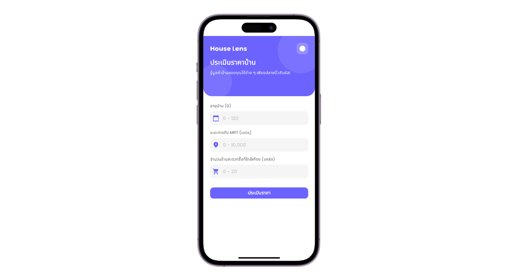
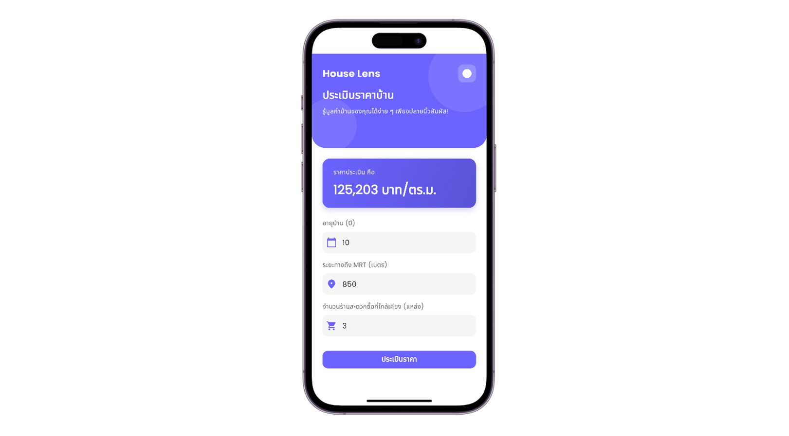
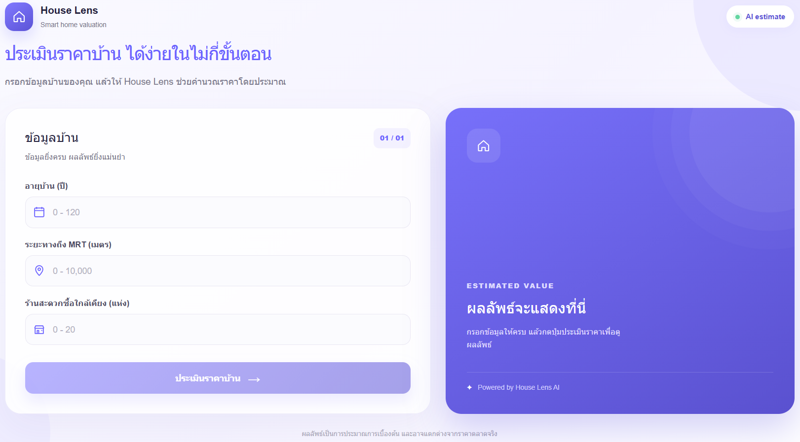
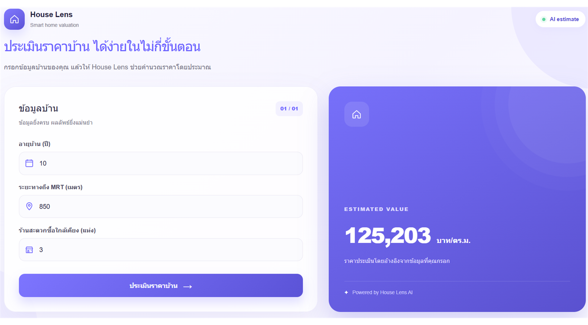

# House Price Prediction

โปรเจกต์สำหรับประเมินราคาบ้านต่อตารางเมตรจากอายุบ้าน ระยะทางถึง MRT และจำนวนร้านสะดวกซื้อใกล้เคียง โดยมี Mobile Application, Web Application และ REST API ที่เชื่อมต่อกับโมเดล Machine Learning

## ภาพหน้าจอ

ภาพด้านล่างเรียงลำดับจาก Mobile Application ไปยัง Web Application เพื่อให้เห็นขั้นตอนการใช้งานทั้งหน้าฟอร์มและหน้าผลลัพธ์ โดยภาพทั้งหมดเชื่อมต่อกับ Backend API สำเร็จ

### Mobile Application: แบบฟอร์มเริ่มต้น

หน้าฟอร์มสำหรับกรอกอายุบ้าน ระยะทางถึง MRT และจำนวนร้านสะดวกซื้อใกล้เคียง



### Mobile Application: ผลลัพธ์หลังคำนวณ

หน้าผลลัพธ์ราคาประเมินที่ได้จากข้อมูลของผู้ใช้



### Web Application: แบบฟอร์มเริ่มต้น

หน้าฟอร์มของ Web Application ที่ใช้ข้อมูลชุดเดียวกันในการประเมินราคา



### Web Application: ผลลัพธ์หลังคำนวณ

หน้าผลลัพธ์ราคาประเมินบน Web Application



## ภาพรวมการทำงาน

```text
ผู้ใช้ (Mobile / Web)
        │  POST /api/house
        ▼
Flask API :8000
        │  age, distance, minimart
        ▼
Linear Regression Model (.pkl)
        │
        ▼
ราคาประเมิน (บาท/ตร.ม.)
```

## ความสามารถของระบบ

- รับข้อมูลอายุบ้าน ระยะทางถึง MRT และจำนวนร้านสะดวกซื้อใกล้เคียง
- ตรวจสอบชนิดข้อมูลและช่วงของค่าที่รับเข้ามา
- ประเมินราคาบ้านผ่านโมเดล Linear Regression
- ใช้งานผ่าน Mobile หรือ Web Application
- แสดงผลราคาเป็นบาทต่อตารางเมตร

## Tech Stack

| ส่วนระบบ | เทคโนโลยี | หน้าที่ |
|---|---|---|
| Mobile | Flutter, Dart | แอปสำหรับ Android, iOS, Web, Windows, macOS และ Linux |
| Web | Next.js 15, React 19, TypeScript | แบบฟอร์มประเมินราคาในเว็บ |
| Web styling | Tailwind CSS 4 | Layout และ styling ของหน้าเว็บ |
| API | Python, Flask, Flask-CORS | รับข้อมูลและส่งผลการทำนาย |
| Validation | Pydantic | ตรวจสอบชนิดและช่วงของ input |
| ML | scikit-learn `LinearRegression` | โมเดลทำนายราคา |
| Data | pandas, NumPy | อ่านและเตรียมข้อมูล |
| Model persistence | joblib | บันทึก/โหลดโมเดล `.pkl` |

## โครงสร้างไฟล์

```text
house_price/
├── backend/
│   └── model/
│       ├── api.py                 # Flask REST API และ validation ของ request
│       ├── model.py               # เทรนและ export โมเดล Linear Regression
│       ├── house_price.csv        # ชุดข้อมูลสำหรับ train/test
│       ├── house_price_model.pkl  # โมเดลที่ train แล้ว
│       └── requirements.txt       # Python dependencies ของ Backend
├── frontend/
│   ├── mobile/
│   │   ├── lib/main.dart          # Flutter application และ API client
│   │   ├── pubspec.yaml           # Flutter dependencies
│   │   ├── test/                  # Widget tests
│   │   └── android/ ios/ macos/   # Platform-specific project files
│   └── web/
│       ├── src/app/page.tsx       # หน้าแบบฟอร์มประเมินราคาบ้าน
│       ├── src/app/layout.tsx     # Root layout และ metadata ของ Next.js
│       ├── src/app/globals.css    # Global styles
│       ├── public/                # Static assets
│       ├── package.json           # Scripts และ dependencies ของ Web
│       └── next.config.ts         # Next.js configuration
├── docs/
│   └── screenshots/               # ภาพประกอบใน README
└── README.md
```

## ข้อมูลที่ใช้ทำนาย

| Field | ชนิด | ช่วงที่รองรับ | หน่วย |
|---|---:|---:|---|
| `age` | integer | 0–120 | ปี |
| `distance` | integer | 0–10,000 | เมตรจาก MRT |
| `minimart` | integer | 0–20 | จำนวนร้าน |

โมเดลแบ่งข้อมูลเป็น training set 70% และ test set 30% ด้วย `random_state=0` จากนั้นประเมินด้วย MAPE ก่อน export เป็น `house_price_model.pkl` ผลลัพธ์เป็นการประมาณจากชุดข้อมูล ไม่ใช่ราคาซื้อขายจริง

## ข้อกำหนดเบื้องต้น

- Python 3.9 ขึ้นไป พร้อม `pip`
- Node.js และ npm สำหรับ Web
- Flutter SDK สำหรับ Mobile
- Android Emulator, iOS Simulator หรืออุปกรณ์จริง หากต้องการรัน Mobile

## การติดตั้งและการรัน

ลำดับการรันระบบคือ Backend API → Mobile Application → Web Application เพื่อให้ทั้งสองแอปเชื่อมต่อ API ได้ก่อนเริ่มใช้งาน

### 1. Backend API

```bash
cd backend/model
python -m venv .venv

# Windows PowerShell
.venv\Scripts\Activate.ps1

pip install -r requirements.txt
python api.py
```

บน macOS/Linux ให้เปิดใช้งาน virtual environment ด้วย `source .venv/bin/activate` แทนคำสั่งของ Windows

API จะทำงานที่ `http://127.0.0.1:8000` โดย `api.py` โหลด `house_price_model.pkl` จากโฟลเดอร์ปัจจุบัน จึงควรรันคำสั่งจาก `backend/model` ตามตัวอย่าง

### Train โมเดลใหม่

หากมีการแก้ไขข้อมูลใน `house_price.csv` หรือต้องการสร้างโมเดลใหม่ ให้รัน `model.py` จากโฟลเดอร์เดียวกับไฟล์ dataset และโมเดล:

```bash
cd backend/model

# เปิดใช้งาน virtual environment ก่อน หากยังไม่ได้เปิด
# Windows PowerShell
.venv\Scripts\Activate.ps1

python model.py
```

กระบวนการ train จะทำงานตามลำดับดังนี้:

1. อ่านข้อมูลจาก `house_price.csv`
2. แบ่งข้อมูลเป็น training set 70% และ test set 30% ด้วย `random_state=0`
3. train โมเดล `LinearRegression`
4. คำนวณค่า MAPE และแสดงผลใน terminal
5. บันทึกโมเดลใหม่เป็น `house_price_model.pkl`

ไฟล์ `house_price_model.pkl` เดิมจะถูกเขียนทับเมื่อ train สำเร็จ ดังนั้นควรสำรองไฟล์เดิมก่อน หากต้องการเก็บโมเดลเวอร์ชันก่อนหน้า หลัง train เสร็จให้ restart API เพื่อให้ API โหลดโมเดลใหม่:

```bash
python api.py
```


### 2. Mobile Application

```bash
cd frontend/mobile
flutter pub get
flutter devices
flutter run
```

โค้ด Mobile เรียก API ที่ `http://127.0.0.1:8000/api/house` หากรัน API บน Server หรือ IP อื่นให้ระบุ IP ให้ถูกต้อง เช่น

```dart
Uri.parse('http://192.168.1.101:8000/api/house')
```

สำหรับ iOS Simulator หรือการรันบน desktop ให้เลือก host ที่เครื่องปลายทางเข้าถึง backend ได้ และตรวจสอบ firewall หากเชื่อมต่อไม่ได้

### 3. Web Application

```bash
cd frontend/web
npm install
npm run dev
```

บน Windows PowerShell หากคำสั่ง `npm` ถูกบล็อกด้วย Execution Policy ให้ใช้ `npm.cmd` แทน เช่น `npm.cmd install` และ `npm.cmd run dev`

เปิด [http://localhost:3000](http://localhost:3000) แล้วกรอกข้อมูลทั้ง 3 ช่อง จากนั้นกด **คำนวณราคา**

คำสั่งสำหรับ production build:

```bash
npm run build
npm run start
```

Web เรียก `POST http://127.0.0.1:8000/api/house` โดยตรง หาก backend อยู่คนละเครื่องหรือใช้คนละ port ให้แก้ URL ใน `frontend/web/src/app/page.tsx`

## วิธีการใช้งาน

1. เปิด Backend API ที่ port `8000`
2. เปิด Mobile ผ่าน Flutter หรือเปิด Web ที่ port `3000`
3. กรอกอายุบ้าน ระยะทางถึง MRT และจำนวนร้านสะดวกซื้อใน Mobile หรือ Web
4. กดปุ่ม **คำนวณราคา**
5. อ่านผลราคาประเมินที่แสดงเป็นบาทต่อตารางเมตร

## API Reference

### `GET /api/hello`

ใช้ตรวจสอบว่า API ทำงานอยู่:

```bash
curl http://127.0.0.1:8000/api/hello
```

ผลลัพธ์ตัวอย่าง:

```json
{"message":"hello world"}
```

### `POST /api/house`

Request:

```json
{
  "age": 10,
  "distance": 850,
  "minimart": 3
}
```

Response เมื่อสำเร็จ:

```json
{
  "status": true,
  "price": 12345.67,
  "currency": "บาท/ตร.ม."
}
```

หากข้อมูลไม่ผ่าน validation API จะคืน HTTP `400` พร้อมรายละเอียดใน `detail` เช่น ค่าติดลบหรืออยู่นอกช่วงที่กำหนด

## ข้อควรทราบ

- Frontend ปัจจุบันกำหนด API URL ไว้ใน source code ยังไม่มี `.env` หรือ environment-based configuration
- ค่า `CORS(app)` เปิดให้ทุก origin ในโหมดปัจจุบัน ควรจำกัด origin ก่อน deploy จริง
- ไม่ควร commit secret หรือข้อมูลส่วนบุคคลลง repository
- ไฟล์ `.pkl` ควรโหลดจากแหล่งที่เชื่อถือได้เท่านั้น เพราะการ deserialize อาจมีความเสี่ยงด้านความปลอดภัย
